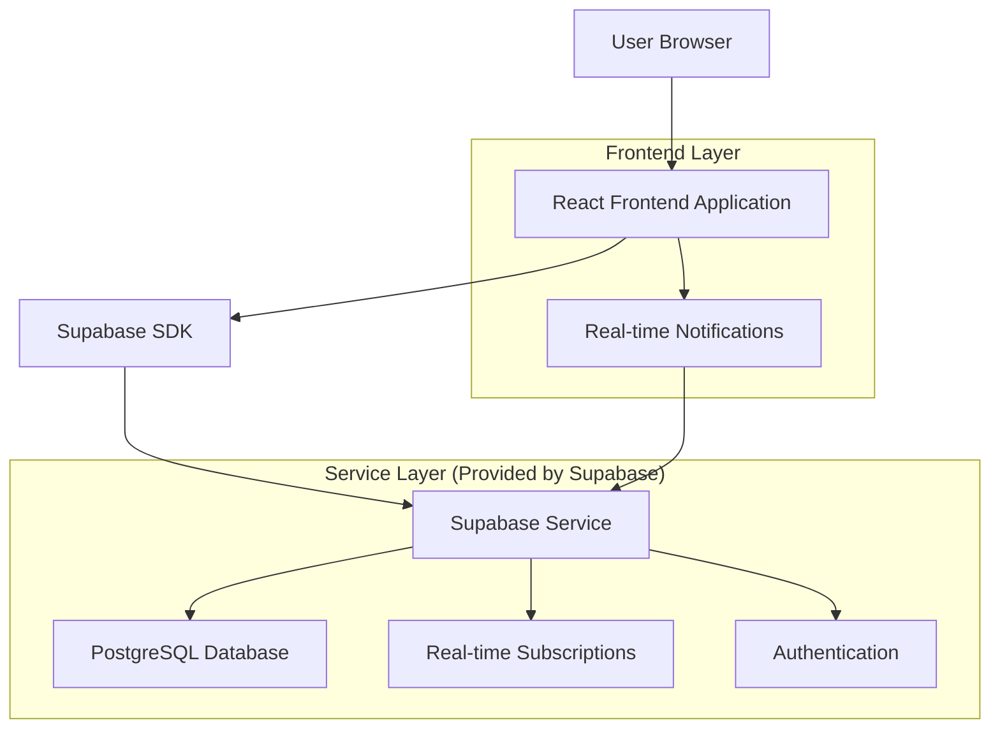
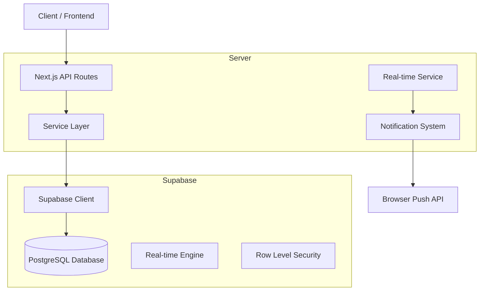
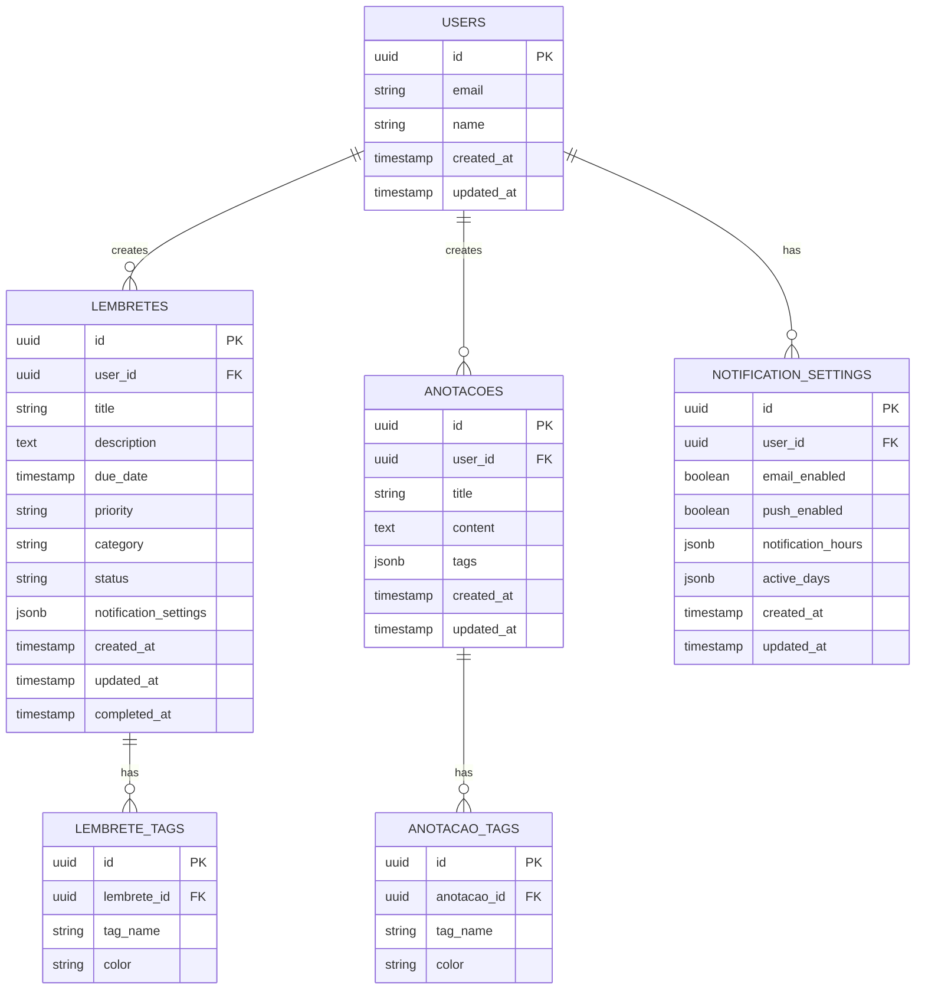

# Arquitetura Técnica - Sistema de Lembretes e Anotações

## 1. Architecture design



## 2. Technology Description

- Frontend: React@18 + TypeScript + tailwindcss@3 + vite
- Backend: Supabase (PostgreSQL + Real-time + Auth)
- Notifications: Supabase Real-time + Browser Notifications API
- State Management: React Query + Zustand
- UI Components: shadcn/ui + Lucide React

## 3. Route definitions

| Route | Purpose |
|-------|---------|
| /lembretes | Dashboard principal de lembretes com visão geral |
| /lembretes/lista | Lista completa de lembretes com filtros |
| /lembretes/novo | Formulário para criar novo lembrete |
| /lembretes/[id] | Visualizar/editar lembrete específico |
| /lembretes/anotacoes | Gerenciamento de anotações livres |
| /lembretes/configuracoes | Configurações de notificações e preferências |

## 4. API definitions

### 4.1 Core API

**Lembretes CRUD**
```
GET /api/lembretes
POST /api/lembretes
PUT /api/lembretes/[id]
DELETE /api/lembretes/[id]
```

**Buscar lembretes**
```
GET /api/lembretes/search
```

Request:
| Param Name| Param Type  | isRequired  | Description |
|-----------|-------------|-------------|-------------|
| query     | string      | false       | Texto para busca |
| status    | string      | false       | Status do lembrete (pending, completed, overdue) |
| category  | string      | false       | Categoria do lembrete |
| priority  | string      | false       | Prioridade (low, medium, high, urgent) |
| dateFrom  | string      | false       | Data inicial (ISO format) |
| dateTo    | string      | false       | Data final (ISO format) |

Response:
| Param Name| Param Type  | Description |
|-----------|-------------|-------------|
| lembretes | array       | Lista de lembretes encontrados |
| total     | number      | Total de resultados |
| page      | number      | Página atual |

**Marcar lembrete como concluído**
```
PATCH /api/lembretes/[id]/complete
```

**Anotações CRUD**
```
GET /api/anotacoes
POST /api/anotacoes
PUT /api/anotacoes/[id]
DELETE /api/anotacoes/[id]
```

**Configurações de notificação**
```
GET /api/lembretes/configuracoes
PUT /api/lembretes/configuracoes
```

Example Request:
```json
{
  "title": "Renovar servidor cliente X",
  "description": "Verificar status e processar renovação",
  "dueDate": "2024-01-15T10:00:00Z",
  "priority": "high",
  "category": "cliente",
  "notifications": {
    "enabled": true,
    "intervals": ["1day", "1hour", "15min"]
  }
}
```

## 5. Server architecture diagram



## 6. Data model

### 6.1 Data model definition



### 6.2 Data Definition Language

**Tabela de Lembretes (lembretes)**
```sql
-- create table
CREATE TABLE lembretes (
    id UUID PRIMARY KEY DEFAULT gen_random_uuid(),
    user_id UUID NOT NULL REFERENCES auth.users(id) ON DELETE CASCADE,
    title VARCHAR(255) NOT NULL,
    description TEXT,
    due_date TIMESTAMP WITH TIME ZONE,
    priority VARCHAR(20) DEFAULT 'medium' CHECK (priority IN ('low', 'medium', 'high', 'urgent')),
    category VARCHAR(50) DEFAULT 'geral',
    status VARCHAR(20) DEFAULT 'pending' CHECK (status IN ('pending', 'completed', 'overdue')),
    notification_settings JSONB DEFAULT '{"enabled": true, "intervals": ["1day"]}',
    created_at TIMESTAMP WITH TIME ZONE DEFAULT NOW(),
    updated_at TIMESTAMP WITH TIME ZONE DEFAULT NOW(),
    completed_at TIMESTAMP WITH TIME ZONE
);

-- create indexes
CREATE INDEX idx_lembretes_user_id ON lembretes(user_id);
CREATE INDEX idx_lembretes_due_date ON lembretes(due_date);
CREATE INDEX idx_lembretes_status ON lembretes(status);
CREATE INDEX idx_lembretes_priority ON lembretes(priority);
CREATE INDEX idx_lembretes_category ON lembretes(category);

-- RLS policies
ALTER TABLE lembretes ENABLE ROW LEVEL SECURITY;

CREATE POLICY "Users can view own lembretes" ON lembretes
    FOR SELECT USING (auth.uid() = user_id);

CREATE POLICY "Users can insert own lembretes" ON lembretes
    FOR INSERT WITH CHECK (auth.uid() = user_id);

CREATE POLICY "Users can update own lembretes" ON lembretes
    FOR UPDATE USING (auth.uid() = user_id);

CREATE POLICY "Users can delete own lembretes" ON lembretes
    FOR DELETE USING (auth.uid() = user_id);
```

**Tabela de Anotações (anotacoes)**
```sql
-- create table
CREATE TABLE anotacoes (
    id UUID PRIMARY KEY DEFAULT gen_random_uuid(),
    user_id UUID NOT NULL REFERENCES auth.users(id) ON DELETE CASCADE,
    title VARCHAR(255) NOT NULL,
    content TEXT NOT NULL,
    tags JSONB DEFAULT '[]',
    created_at TIMESTAMP WITH TIME ZONE DEFAULT NOW(),
    updated_at TIMESTAMP WITH TIME ZONE DEFAULT NOW()
);

-- create indexes
CREATE INDEX idx_anotacoes_user_id ON anotacoes(user_id);
CREATE INDEX idx_anotacoes_created_at ON anotacoes(created_at DESC);
CREATE INDEX idx_anotacoes_tags ON anotacoes USING GIN(tags);
CREATE INDEX idx_anotacoes_content_search ON anotacoes USING GIN(to_tsvector('portuguese', content));

-- RLS policies
ALTER TABLE anotacoes ENABLE ROW LEVEL SECURITY;

CREATE POLICY "Users can view own anotacoes" ON anotacoes
    FOR SELECT USING (auth.uid() = user_id);

CREATE POLICY "Users can insert own anotacoes" ON anotacoes
    FOR INSERT WITH CHECK (auth.uid() = user_id);

CREATE POLICY "Users can update own anotacoes" ON anotacoes
    FOR UPDATE USING (auth.uid() = user_id);

CREATE POLICY "Users can delete own anotacoes" ON anotacoes
    FOR DELETE USING (auth.uid() = user_id);
```

**Tabela de Configurações de Notificação (notification_settings)**
```sql
-- create table
CREATE TABLE notification_settings (
    id UUID PRIMARY KEY DEFAULT gen_random_uuid(),
    user_id UUID NOT NULL REFERENCES auth.users(id) ON DELETE CASCADE UNIQUE,
    email_enabled BOOLEAN DEFAULT true,
    push_enabled BOOLEAN DEFAULT true,
    notification_hours JSONB DEFAULT '{"start": "09:00", "end": "18:00"}',
    active_days JSONB DEFAULT '["monday", "tuesday", "wednesday", "thursday", "friday"]',
    created_at TIMESTAMP WITH TIME ZONE DEFAULT NOW(),
    updated_at TIMESTAMP WITH TIME ZONE DEFAULT NOW()
);

-- create indexes
CREATE UNIQUE INDEX idx_notification_settings_user_id ON notification_settings(user_id);

-- RLS policies
ALTER TABLE notification_settings ENABLE ROW LEVEL SECURITY;

CREATE POLICY "Users can view own notification settings" ON notification_settings
    FOR SELECT USING (auth.uid() = user_id);

CREATE POLICY "Users can insert own notification settings" ON notification_settings
    FOR INSERT WITH CHECK (auth.uid() = user_id);

CREATE POLICY "Users can update own notification settings" ON notification_settings
    FOR UPDATE USING (auth.uid() = user_id);

-- init data
INSERT INTO notification_settings (user_id, email_enabled, push_enabled)
SELECT id, true, true FROM auth.users
ON CONFLICT (user_id) DO NOTHING;
```

**Função para atualizar status de lembretes vencidos**
```sql
-- Function to update overdue reminders
CREATE OR REPLACE FUNCTION update_overdue_lembretes()
RETURNS void AS $$
BEGIN
    UPDATE lembretes 
    SET status = 'overdue', updated_at = NOW()
    WHERE due_date < NOW() 
    AND status = 'pending';
END;
$$ LANGUAGE plpgsql;

-- Schedule function to run every hour
SELECT cron.schedule('update-overdue-lembretes', '0 * * * *', 'SELECT update_overdue_lembretes();');
```