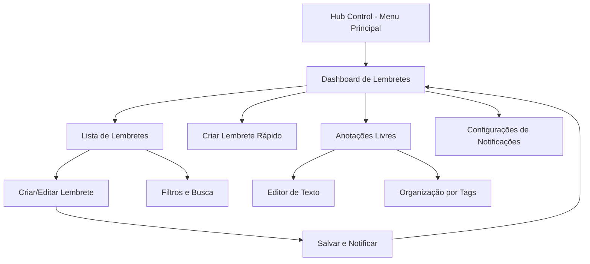

# Sistema de Lembretes e Anotações - Hub Control

## 1. Product Overview

Sistema integrado de gerenciamento de lembretes e anotações que permite aos usuários (empresas) organizar tarefas, fazer anotações e receber notificações inteligentes dentro do Hub Control.

O sistema resolve a necessidade de centralizar o gerenciamento de tarefas empresariais em uma única plataforma, eliminando a dependência de ferramentas externas e proporcionando maior produtividade e organização para gestores de IPTV.

Objetivo: Aumentar a eficiência operacional dos usuários em 40% através de um sistema de lembretes integrado e intuitivo.

## 2. Core Features

### 2.1 User Roles

| Role | Registration Method | Core Permissions |
|------|---------------------|------------------|
| Usuário Autenticado | Login existente no Hub Control | Pode criar, editar, visualizar e excluir seus próprios lembretes e anotações |
| Admin | Acesso administrativo existente | Pode visualizar estatísticas gerais de uso do sistema (sem acesso aos conteúdos privados) |

### 2.2 Feature Module

Nosso sistema de lembretes consiste nas seguintes páginas principais:

1. **Dashboard de Lembretes**: visão geral, lembretes pendentes, estatísticas rápidas, ações rápidas.
2. **Lista de Lembretes**: listagem completa, filtros avançados, busca, ordenação.
3. **Criar/Editar Lembrete**: formulário de criação, configurações de notificação, categorização.
4. **Anotações Livres**: editor de texto, organização por tags, busca de conteúdo.
5. **Configurações de Notificações**: preferências de alerta, horários, canais de notificação.

### 2.3 Page Details

| Page Name | Module Name | Feature description |
|-----------|-------------|---------------------|
| Dashboard de Lembretes | Visão Geral | Exibir lembretes próximos ao vencimento, estatísticas de produtividade, ações rápidas para criar novos lembretes |
| Dashboard de Lembretes | Lembretes Pendentes | Listar próximos 5 lembretes por prioridade e data, marcar como concluído com um clique |
| Dashboard de Lembretes | Estatísticas Rápidas | Mostrar total de lembretes ativos, concluídos hoje, vencidos, gráfico de produtividade semanal |
| Lista de Lembretes | Listagem Completa | Exibir todos os lembretes com paginação, status visual, ordenação por data/prioridade |
| Lista de Lembretes | Filtros Avançados | Filtrar por status (pendente, concluído, vencido), categoria, período de data, prioridade |
| Lista de Lembretes | Busca e Ordenação | Buscar por título/descrição, ordenar por data criação/vencimento/prioridade |
| Criar/Editar Lembrete | Formulário Principal | Inserir título, descrição, data/hora vencimento, selecionar prioridade e categoria |
| Criar/Editar Lembrete | Configurações Notificação | Definir alertas (15min, 1h, 1dia antes), repetição (única, diária, semanal, mensal) |
| Criar/Editar Lembrete | Categorização | Selecionar categoria predefinida ou criar nova, adicionar tags personalizadas |
| Anotações Livres | Editor de Texto | Criar anotações com editor rich text, salvar automaticamente, organizar por data |
| Anotações Livres | Organização por Tags | Adicionar tags às anotações, filtrar por tags, buscar conteúdo nas anotações |
| Anotações Livres | Busca de Conteúdo | Busca full-text nas anotações, filtros por data de criação/modificação |
| Configurações Notificações | Preferências de Alerta | Configurar horários de notificação, dias da semana ativos, tipos de alerta |
| Configurações Notificações | Canais de Notificação | Ativar/desativar notificações in-app, email, configurar templates de mensagem |

## 3. Core Process

**Fluxo Principal do Usuário:**

O usuário acessa o Dashboard de Lembretes através do menu principal do Hub Control. Na visão geral, visualiza lembretes próximos ao vencimento e pode criar novos lembretes rapidamente. Para gerenciamento completo, acessa a Lista de Lembretes onde pode filtrar, buscar e organizar todas as tarefas. Ao criar um novo lembrete, preenche as informações básicas e configura notificações personalizadas. Para anotações livres, utiliza o editor de texto integrado com sistema de tags. As configurações de notificação permitem personalizar completamente como e quando receber alertas.

## 4. User Interface Design

### 4.1 Design Style

- **Cores Primárias**: Azul Hub Control (#3B82F6), Verde Sucesso (#10B981), Amarelo Alerta (#F59E0B), Vermelho Urgente (#EF4444)
- **Cores Secundárias**: Cinza Neutro (#6B7280), Branco (#FFFFFF), Cinza Claro (#F9FAFB)
- **Estilo de Botões**: Rounded corners (8px), sombras sutis, estados hover/active bem definidos
- **Tipografia**: Inter como fonte principal, tamanhos 14px (corpo), 16px (títulos), 12px (legendas)
- **Layout**: Card-based design, navegação lateral integrada ao Hub Control, espaçamento consistente (16px/24px)
- **Ícones**: Lucide React icons, estilo outline, tamanho 20px para ações principais, 16px para secundárias

### 4.2 Page Design Overview

| Page Name | Module Name | UI Elements |
|-----------|-------------|-------------|
| Dashboard de Lembretes | Visão Geral | Cards com gradiente sutil, ícones coloridos por prioridade, layout grid responsivo 2x2 |
| Dashboard de Lembretes | Lembretes Pendentes | Lista vertical com checkboxes, badges de prioridade, hover effects, botão flutuante "+" |
| Lista de Lembretes | Listagem Completa | Tabela responsiva, filtros em sidebar colapsível, paginação inferior, cores por status |
| Lista de Lembretes | Filtros Avançados | Sidebar com accordions, date pickers, multi-select dropdowns, botão "Limpar Filtros" |
| Criar/Editar Lembrete | Formulário Principal | Modal ou página dedicada, campos com validação visual, preview da notificação |
| Anotações Livres | Editor de Texto | Interface tipo Notion, toolbar flutuante, auto-save indicator, contador de palavras |
| Configurações Notificações | Preferências | Toggle switches, time pickers, cards de configuração, preview de notificações |

### 4.3 Responsividade

Design mobile-first com breakpoints em 768px (tablet) e 1024px (desktop). Em mobile, navegação por tabs na parte inferior, cards empilhados verticalmente, e formulários em tela cheia. Touch-friendly com botões mínimos de 44px e gestos de swipe para ações rápidas.

