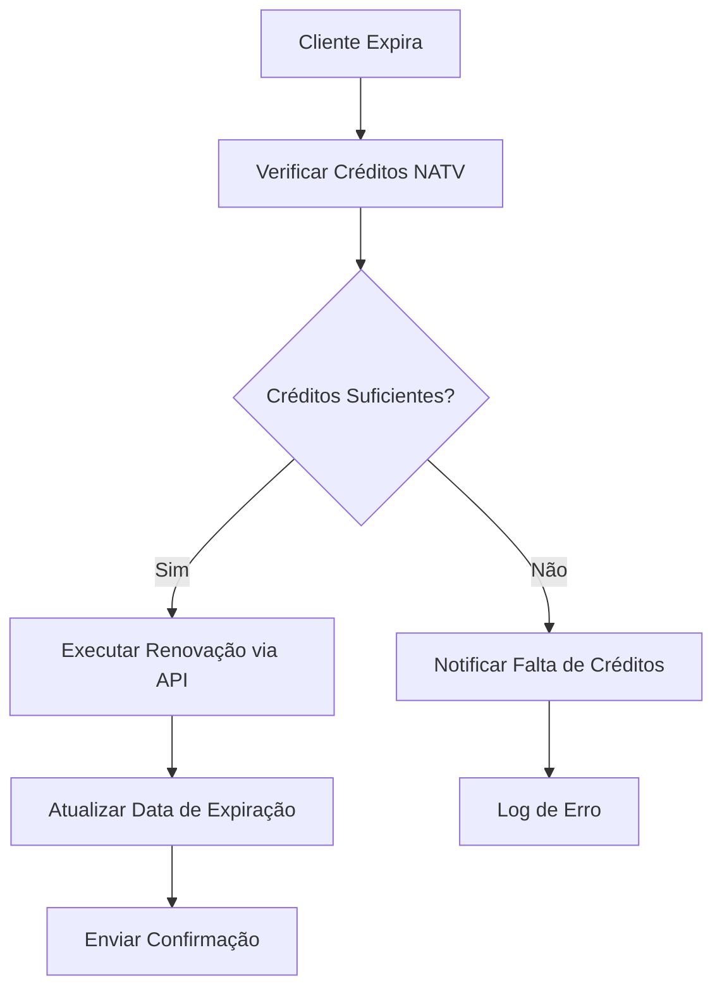
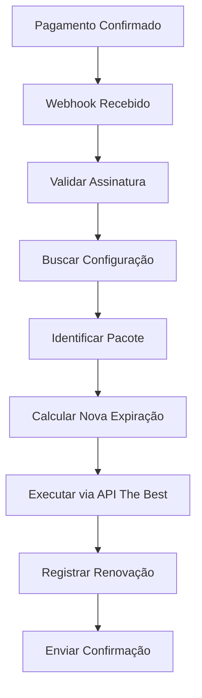
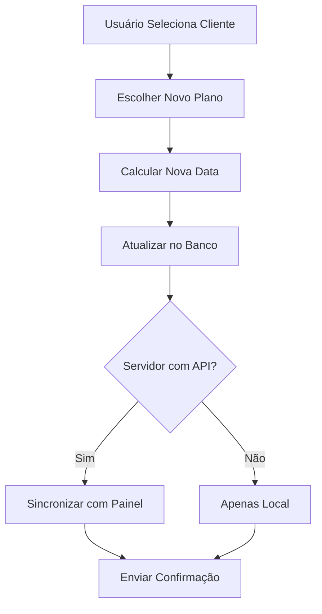

# 📋 Documentação: Lógica de Planos e Renovações

## 🎯 Visão Geral

Este documento descreve a lógica completa de planos e renovações no HubControl, incluindo estrutura de dados, processos de renovação automática e manual, e integração com painéis IPTV.

## 🏗️ Estrutura de Planos

### 1. Grupos de Planos (`plan_groups`)

```sql
CREATE TABLE plan_groups (
  id UUID PRIMARY KEY DEFAULT gen_random_uuid(),
  name TEXT NOT NULL,
  description TEXT,
  is_active BOOLEAN DEFAULT TRUE,
  created_at TIMESTAMP WITH TIME ZONE DEFAULT NOW(),
  updated_at TIMESTAMP WITH TIME ZONE DEFAULT NOW()
);
```

**Características:**
- Organizam planos em categorias lógicas
- Facilitam a gestão e apresentação de planos
- Permitem agrupamento por tipo de serviço (ex: "Planos Básicos", "Planos Premium")
- Relacionamento 1:N com planos

### 2. Planos (`plans`)

```sql
CREATE TABLE plans (
  id UUID PRIMARY KEY DEFAULT gen_random_uuid(),
  name TEXT NOT NULL,
  price DECIMAL NOT NULL,
  price_before_discount DECIMAL,
  validity INTEGER NOT NULL,           -- Dias de validade
  screens INTEGER NOT NULL,            -- Número de conexões/telas
  panel_plan_id TEXT,                  -- ID do plano no painel IPTV
  restrictions TEXT,                   -- Restrições específicas
  send_welcome_message BOOLEAN DEFAULT TRUE,
  is_public BOOLEAN DEFAULT TRUE,      -- Visível para clientes
  group_id UUID REFERENCES plan_groups(id),
  created_at TIMESTAMP WITH TIME ZONE DEFAULT NOW(),
  updated_at TIMESTAMP WITH TIME ZONE DEFAULT NOW()
);
```

**Características:**
- **Preço**: Valor do plano (com desconto opcional)
- **Validade**: Período em dias (ex: 30, 90, 365)
- **Telas**: Número de conexões simultâneas permitidas
- **Panel Plan ID**: Identificador do plano no painel IPTV específico
- **Restrições**: Limitações específicas do plano
- **Visibilidade**: Controla se o plano aparece para clientes

## 👥 Estrutura de Clientes

### Cliente (`clients`)

```sql
CREATE TABLE clients (
  id UUID PRIMARY KEY DEFAULT gen_random_uuid(),
  name TEXT NOT NULL,
  iptv_username TEXT NOT NULL,
  iptv_user_id TEXT,                   -- ID no painel IPTV
  iptv_password TEXT,
  manager_id TEXT,                     -- ID do gestor
  email TEXT,
  whatsapp TEXT,
  start_date TIMESTAMP WITH TIME ZONE DEFAULT NOW(),
  expiration_date TIMESTAMP WITH TIME ZONE NOT NULL,
  status TEXT CHECK (status IN ('Ativo', 'Em teste', 'Inativo', 'Bloqueado')),
  plan_id UUID REFERENCES plans(id),
  server_id UUID REFERENCES servers(id),
  unique_link TEXT UNIQUE,             -- Link único para área do cliente
  notes TEXT,
  payment_history JSONB,
  created_at TIMESTAMP WITH TIME ZONE DEFAULT NOW(),
  updated_at TIMESTAMP WITH TIME ZONE DEFAULT NOW()
);
```

**Relacionamentos:**
- **Plan ID**: Plano atual do cliente
- **Server ID**: Servidor IPTV onde está ativo
- **Unique Link**: Acesso à área do cliente

## 🔄 Processo de Renovação

### 1. Renovação Manual

#### Fluxo no HubControl:

```typescript
// Função de renovação manual
export async function renewCustomerAction(customerId: string, planValidity: number) {
  const supabase = await createApiSupabaseClient();
  
  // 1. Buscar data de expiração atual
  const { data, error } = await supabase
    .from('clients')
    .select('expiration_date')
    .eq('id', customerId)
    .single();
  
  if (error || !data) return { success: false, error: "Cliente não encontrado" };
  
  // 2. Calcular nova data de expiração
  const currentExpiration = new Date(data.expiration_date);
  const baseDate = currentExpiration > new Date() ? currentExpiration : new Date();
  const newExpirationDate = addDays(baseDate, planValidity);
  
  // 3. Atualizar cliente
  const { error: updateError } = await supabase
    .from('clients')
    .update({ 
      expiration_date: newExpirationDate.toISOString(), 
      status: 'Ativo' 
    })
    .eq('id', customerId);
  
  // 4. Enviar mensagem de confirmação
  if (!updateError) {
    await MessageQueueService.getInstance().queueWelcomeMessage({
      type: 'renewal',
      clientId: client.id,
      clientName: client.name,
      // ... outros dados
    });
  }
}
```

#### Características da Renovação Manual:
- **Base de Cálculo**: Se o cliente ainda está ativo, adiciona dias à data atual de expiração. Se expirado, usa a data atual
- **Status**: Automaticamente define como "Ativo"
- **Notificação**: Envia mensagem de confirmação de renovação
- **Flexibilidade**: Permite renovar com qualquer plano disponível

### 2. Renovação Automática

#### Integrações Suportadas:

##### A. NATV Integration

```typescript
// Serviço NATV para renovação
class NATVService {
  // Ativa ou renova usuário
  async activateUser(request: NATVActivationRequest): Promise<NATVApiResponse<NATVUser>> {
    return this.makeRequest<NATVUser>('/user/activation', 'POST', request);
  }
  
  // Cria novo usuário
  async createUser(request: NATVCreateUserRequest): Promise<NATVApiResponse<NATVUser>> {
    return this.makeRequest<NATVUser>('/user', 'POST', request);
  }
}
```

**Características NATV:**
- Sistema de créditos
- API REST para ativação/renovação
- Sincronização automática de créditos
- Suporte a configurações por usuário

##### B. The Best Integration

```typescript
// Serviço de renovação The Best
class TheBestRenewalService {
  async processAutoRenewal(paymentData: PaymentData): Promise<RenewalResult> {
    // 1. Buscar informações do pacote
    const packageInfo = await this.getPackageInfo(paymentData.packageId);
    
    // 2. Verificar configuração do usuário
    const userConfig = await this.getUserConfig(paymentData.userId);
    
    // 3. Calcular data de expiração
    const expirationDate = this.calculateExpirationDate(packageInfo.duration_months);
    
    // 4. Executar renovação via API
    const renewalResponse = await this.executeRenewal({
      userConfig,
      packageInfo,
      paymentData,
      expirationDate
    });
    
    // 5. Registrar no banco
    const renewalRecord = await this.createRenewalRecord({
      userId: paymentData.userId,
      packageId: paymentData.packageId,
      paymentId: paymentData.paymentId,
      packageInfo,
      expirationDate,
      apiResponse: renewalResponse.data
    });
    
    return { success: true, renewalId: renewalRecord.id };
  }
}
```

**Características The Best:**
- Renovação baseada em webhooks de pagamento
- Pacotes pré-configurados com créditos
- Classificação por tipo (COM_ADULTO, SEM_ADULTO)
- Durações variadas (1, 3, 6, 12 meses)
- Log completo de operações

## 🔧 Configuração de Servidores

### Estrutura de Servidor (`servers`)

```sql
CREATE TABLE servers (
  id UUID PRIMARY KEY DEFAULT gen_random_uuid(),
  name TEXT NOT NULL,
  url TEXT,
  api_key TEXT,
  status TEXT CHECK (status IN ('Online', 'Offline', 'Instável')),
  integration_type TEXT CHECK (integration_type IN ('generic', 'pixbot', 'natv', 'thebest', 'none')),
  test_automation BOOLEAN DEFAULT FALSE,
  test_config JSONB,
  renewal_automation BOOLEAN DEFAULT FALSE,    -- Renovação automática ativa
  payment_gateway BOOLEAN DEFAULT FALSE,       -- Gateway de pagamento ativo
  send_expiration_reminder BOOLEAN DEFAULT FALSE,
  send_usage_instructions BOOLEAN DEFAULT FALSE,
  created_at TIMESTAMP WITH TIME ZONE DEFAULT NOW(),
  updated_at TIMESTAMP WITH TIME ZONE DEFAULT NOW()
);
```

### Configurações de Automação:

1. **Test Automation**: Criação automática de testes
2. **Renewal Automation**: Renovação automática via API
3. **Payment Gateway**: Integração com sistema de pagamentos
4. **Expiration Reminder**: Lembretes de vencimento
5. **Usage Instructions**: Instruções de uso automáticas

## 🎯 Fluxos de Renovação por Integração

### 1. Fluxo NATV



### 2. Fluxo The Best



### 3. Fluxo Manual (HubControl)



## 📊 Sistema de Monitoramento

### 1. Verificação de Expiração

```typescript
// Serviço de lembrete automático
class ReminderService {
  static async checkExpiringClients() {
    const now = new Date();
    const threeDaysFromNow = new Date(now.getTime() + (3 * 24 * 60 * 60 * 1000));
    const oneDayFromNow = new Date(now.getTime() + (1 * 24 * 60 * 60 * 1000));

    // Buscar clientes com vencimento próximo
    const { data: expiringClients } = await supabase
      .from('clients')
      .select('*')
      .eq('status', 'Ativo')
      .or(`expiration_date.lte.${threeDaysFromNow.toISOString()},expiration_date.lte.${oneDayFromNow.toISOString()}`)
      .gte('expiration_date', now.toISOString());

    // Enviar lembretes
    for (const client of expiringClients) {
      await this.sendExpirationReminder(client);
    }
  }
}
```

### 2. Atualização de Status

```typescript
// Atualização automática de clientes expirados
export async function updateExpiredClientsStatus() {
  const supabase = await createApiSupabaseClient();
  
  // Buscar clientes ativos expirados
  const { data: clients } = await supabase
    .from('clients')
    .select('id, expiration_date, status')
    .in('status', ['Ativo', 'Em teste']);
  
  // Filtrar expirados
  const expiredClients = clients.filter(client => {
    const expirationDate = parseISO(client.expiration_date);
    return isPast(expirationDate);
  });
  
  // Atualizar status
  if (expiredClients.length > 0) {
    await supabase
      .from('clients')
      .update({ status: 'Inativo' })
      .in('id', expiredClients.map(c => c.id));
  }
}
```

## 🔐 Segurança e Validações

### 1. Políticas RLS (Row Level Security)

```sql
-- Planos: Todos podem ver, apenas admins podem modificar
CREATE POLICY "Authenticated users can view plans" ON public.plans
  FOR SELECT USING (auth.role() = 'authenticated');

CREATE POLICY "Only admins can manage plans" ON public.plans
  FOR ALL USING (
    EXISTS (
      SELECT 1 FROM public.profiles 
      WHERE id = auth.uid() AND role = 'admin'
    )
  );

-- Grupos de Planos: Mesma lógica
CREATE POLICY "Authenticated users can view plan groups" ON public.plan_groups
  FOR SELECT USING (auth.role() = 'authenticated');

CREATE POLICY "Only admins can manage plan groups" ON public.plan_groups
  FOR ALL USING (
    EXISTS (
      SELECT 1 FROM public.profiles 
      WHERE id = auth.uid() AND role = 'admin'
    )
  );
```

### 2. Validações de Negócio

```typescript
// Validação ao adicionar cliente
export async function addCustomerAction(data: z.infer<typeof addCustomerSchema>, allPlans: Plan[]) {
  // 1. Validar se o plano existe
  const plan = allPlans.find(p => p.id === data.planId);
  if (!plan) {
    return { success: false, error: "Plano não encontrado" };
  }
  
  // 2. Validar ID IPTV para servidores com gateway
  if (data.serverId && data.serverId !== 'none') {
    const servers = await getServers();
    const server = servers.find(s => s.id === data.serverId);
    if (server?.paymentGateway && !data.iptvUserId) {
      return { 
        success: false, 
        error: "O ID IPTV é obrigatório para servidores com gateway de pagamento ativado." 
      };
    }
  }
  
  // 3. Gerar Manager ID único se necessário
  let managerId = data.managerId;
  if (!managerId || !/^([A-Z][0-9]|[A-Z]{3}[0-9]{3})$/.test(managerId)) {
    const { data: existingClients } = await supabase.from('clients').select('manager_id');
    const existingIds = (existingClients || []).map(c => c.manager_id).filter(Boolean);
    managerId = generateUniqueManagerId(existingIds, 'long');
  }
}
```

## 📈 Templates de Notificação

### 1. Confirmação de Renovação

```html
<div style="font-family: Arial, sans-serif; max-width: 600px; margin: 0 auto;">
  <h2 style="color: #27ae60;">✅ Renovação confirmada!</h2>
  <p>Olá <strong>{{nome}}</strong>,</p>
  <p>Sua renovação foi processada com sucesso!</p>
  <div style="background: #e8f5e8; padding: 15px; border-radius: 5px; margin: 20px 0;">
    <p><strong>Detalhes da renovação:</strong></p>
    <ul>
      <li>Nova data de vencimento: {{vencimento}}</li>
      <li>Status: {{status}}</li>
    </ul>
  </div>
  <p>Obrigado por continuar conosco!</p>
</div>
```

### 2. Lembrete de Vencimento

```html
<div style="font-family: Arial, sans-serif; max-width: 600px; margin: 0 auto;">
  <h2 style="color: #e74c3c;">⚠️ Atenção: Seu plano vence em breve!</h2>
  <p>Olá <strong>{{nome}}</strong>,</p>
  <p>Seu plano IPTV vence em <strong>{{vencimento}}</strong>.</p>
  <p>Para evitar a interrupção do serviço, renove seu plano o quanto antes.</p>
  <div style="background: #f8f9fa; padding: 15px; border-radius: 5px; margin: 20px 0;">
    <p><strong>Detalhes da sua conta:</strong></p>
    <ul>
      <li>Usuário: {{usuario}}</li>
      <li>Status: {{status}}</li>
      <li>Data de vencimento: {{vencimento}}</li>
    </ul>
  </div>
</div>
```

## 🚀 Próximos Passos e Melhorias

### 1. Funcionalidades Pendentes

- [ ] **Migração The Best**: Executar migração manual no Dashboard do Supabase
- [ ] **Testes de Integração**: Validar renovação automática completa
- [ ] **Dashboard de Renovações**: Interface para monitorar renovações
- [ ] **Relatórios**: Análise de renovações por período
- [ ] **Webhooks Genéricos**: Suporte a outros gateways de pagamento

### 2. Otimizações

- [ ] **Cache de Planos**: Implementar cache para melhor performance
- [ ] **Fila de Renovações**: Sistema de fila para processar renovações em lote
- [ ] **Retry Logic**: Lógica de retry para falhas de API
- [ ] **Monitoramento**: Alertas para falhas de renovação
- [ ] **Backup**: Sistema de backup para dados críticos

### 3. Integrações Futuras

- [ ] **Novos Painéis**: Suporte a outros painéis IPTV
- [ ] **Gateways de Pagamento**: Integração com PIX, cartão, boleto
- [ ] **CRM**: Integração com sistemas de CRM
- [ ] **Analytics**: Métricas avançadas de renovação

## 📝 Conclusão

O sistema de planos e renovações do HubControl está estruturado de forma robusta e escalável, com suporte a:

- **Flexibilidade**: Grupos de planos e configurações variadas
- **Automação**: Renovação automática via NATV e The Best
- **Monitoramento**: Verificação automática de expiração e status
- **Segurança**: Políticas RLS e validações de negócio
- **Notificações**: Templates personalizáveis para diferentes cenários

A arquitetura permite fácil extensão para novos painéis IPTV e gateways de pagamento, mantendo a consistência e confiabilidade do sistema.