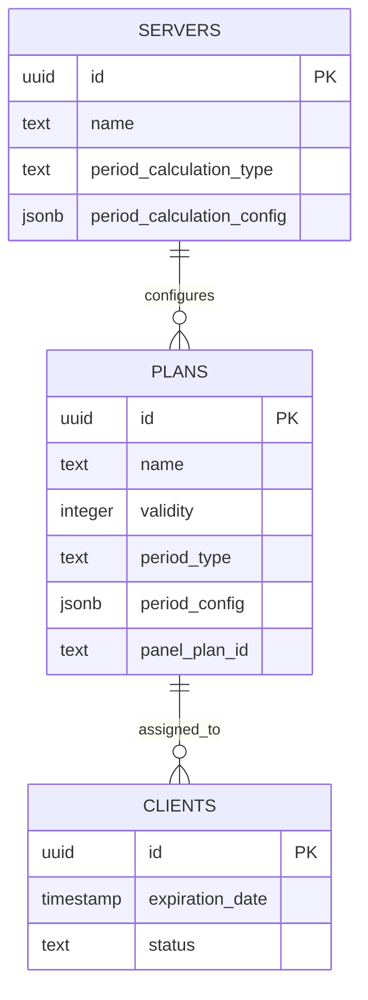

# Plano de Implementação - Compatibilidade de Períodos com Painéis IPTV

## 🎯 Objetivo
Implementar sistema flexível de cálculo de períodos que seja compatível com diferentes lógicas de painéis IPTV (dias vs meses), garantindo sincronização perfeita entre o sistema HubControl e os painéis externos.

## 📋 Resumo Executivo

### Problema
- Sistema atual: Contabiliza validade sempre em **dias**
- Painéis IPTV: Alguns usam **dias**, outros usam **meses**
- Resultado: Inconsistências de datas e problemas de sincronização

### Solução
- Configuração flexível por servidor/painel
- Serviço centralizado de cálculo de períodos
- Interface amigável para configuração
- Migração segura dos dados existentes

### Benefícios
- ✅ Compatibilidade total com qualquer painel IPTV
- ✅ Sincronização precisa de datas
- ✅ Redução de problemas de renovação
- ✅ Facilidade de configuração e manutenção

## 🏗️ Arquitetura da Solução

### 1. Estrutura de Dados



### 2. Fluxo de Cálculo de Períodos

```mermaid
flowchart TD
    A[Renovação Solicitada] --> B[Buscar Configuração do Servidor]
    B --> C{Tipo de Cálculo?}
    C -->|days| D[Calcular em Dias]
    C -->|months| E[Calcular em Meses]
    D --> F[Aplicar addDays()]
    E --> G[Aplicar setMonth()]
    F --> H[Atualizar Cliente]
    G --> H
    H --> I[Sincronizar com Painel]
    I --> J[Log da Operação]
```

## 📅 Cronograma de Implementação

### **Fase 1: Estrutura Base** (Semana 1-2)
**Prioridade: CRÍTICA**

#### Semana 1
- [ ] **Dia 1-2**: Criar migrations para novos campos
- [ ] **Dia 3-4**: Implementar `PeriodCalculationService`
- [ ] **Dia 5**: Criar testes unitários para o serviço

#### Semana 2
- [ ] **Dia 1-2**: Atualizar função `renewCustomerAction`
- [ ] **Dia 3-4**: Migrar dados existentes
- [ ] **Dia 5**: Testes de integração

### **Fase 2: Interface e Configuração** (Semana 3-4)
**Prioridade: ALTA**

#### Semana 3
- [ ] **Dia 1-2**: Criar componente de configuração de servidor
- [ ] **Dia 3-4**: Atualizar formulário de planos
- [ ] **Dia 5**: Implementar validações

#### Semana 4
- [ ] **Dia 1-2**: Criar página de configuração avançada
- [ ] **Dia 3-4**: Implementar presets para painéis conhecidos
- [ ] **Dia 5**: Testes de UI/UX

### **Fase 3: Integração e Otimização** (Semana 5-6)
**Prioridade: MÉDIA**

#### Semana 5
- [ ] **Dia 1-2**: Atualizar integração The Best
- [ ] **Dia 3-4**: Atualizar integração NATV
- [ ] **Dia 5**: Implementar sincronização automática

#### Semana 6
- [ ] **Dia 1-2**: Sistema de monitoramento e alertas
- [ ] **Dia 3-4**: Dashboard de acompanhamento
- [ ] **Dia 5**: Documentação final

## 🔧 Detalhamento Técnico

### 1. **Migrations de Banco de Dados**

```sql
-- Migration 001: Adicionar campos de configuração de período
CREATE OR REPLACE FUNCTION add_period_configuration_fields()
RETURNS void AS $$
BEGIN
    -- Adicionar campos na tabela servers
    ALTER TABLE servers 
    ADD COLUMN IF NOT EXISTS period_calculation_type TEXT DEFAULT 'days' 
    CHECK (period_calculation_type IN ('days', 'months'));
    
    ALTER TABLE servers 
    ADD COLUMN IF NOT EXISTS period_calculation_config JSONB DEFAULT '{}';
    
    -- Adicionar campos na tabela plans
    ALTER TABLE plans 
    ADD COLUMN IF NOT EXISTS period_type TEXT DEFAULT 'days' 
    CHECK (period_type IN ('days', 'months'));
    
    ALTER TABLE plans 
    ADD COLUMN IF NOT EXISTS period_config JSONB DEFAULT '{}';
    
    -- Criar índices para performance
    CREATE INDEX IF NOT EXISTS idx_servers_period_type 
    ON servers(period_calculation_type);
    
    CREATE INDEX IF NOT EXISTS idx_plans_period_type 
    ON plans(period_type);
    
    RAISE NOTICE 'Campos de configuração de período adicionados com sucesso';
END;
$$ LANGUAGE plpgsql;

-- Executar a função
SELECT add_period_configuration_fields();
```

```sql
-- Migration 002: Migrar dados existentes
CREATE OR REPLACE FUNCTION migrate_existing_period_data()
RETURNS void AS $$
BEGIN
    -- Identificar planos que provavelmente são mensais
    UPDATE plans SET 
        period_type = 'months',
        period_config = jsonb_build_object(
            'months', 
            CASE 
                WHEN validity = 30 THEN 1
                WHEN validity = 60 THEN 2
                WHEN validity = 90 THEN 3
                WHEN validity = 180 THEN 6
                WHEN validity = 365 THEN 12
                ELSE ROUND(validity / 30)
            END,
            'migrated', true,
            'original_days', validity
        )
    WHERE validity IN (30, 60, 90, 180, 365)
       OR (validity % 30 = 0 AND validity <= 360);
    
    -- Configurar servidores existentes com padrão de dias
    UPDATE servers SET 
        period_calculation_type = 'days',
        period_calculation_config = jsonb_build_object(
            'strict', true,
            'migrated', true
        )
    WHERE period_calculation_type IS NULL;
    
    RAISE NOTICE 'Migração de dados existentes concluída';
END;
$$ LANGUAGE plpgsql;

-- Executar a migração
SELECT migrate_existing_period_data();
```

### 2. **Serviço de Cálculo de Períodos**

```typescript
// lib/services/period-calculation.service.ts
import { addDays, addMonths, endOfMonth, setDate } from 'date-fns';

export interface ServerPeriodConfig {
  period_calculation_type: 'days' | 'months';
  period_calculation_config: {
    dayOfMonth?: 'same' | 'endOfMonth' | 'fixed';
    fixedDay?: number;
    strict?: boolean;
    allowPartialDays?: boolean;
    handleInvalidDates?: 'lastDayOfMonth' | 'nextValidDay' | 'error';
  };
}

export interface PlanPeriodConfig {
  period_type: 'days' | 'months';
  period_config: {
    months?: number;
    days?: number;
    original_days?: number;
    migrated?: boolean;
  };
}

export class PeriodCalculationService {
  /**
   * Calcula data de expiração baseada na configuração do servidor e plano
   */
  static calculateExpirationDate(
    baseDate: Date,
    planValidity: number,
    serverConfig: ServerPeriodConfig,
    planConfig?: PlanPeriodConfig
  ): Date {
    try {
      // Validar entrada
      if (!baseDate || isNaN(baseDate.getTime())) {
        throw new Error('Data base inválida');
      }
      
      if (planValidity <= 0) {
        throw new Error('Validade do plano deve ser maior que zero');
      }
      
      // Determinar método de cálculo
      const calculationType = serverConfig.period_calculation_type;
      const config = serverConfig.period_calculation_config || {};
      
      switch (calculationType) {
        case 'days':
          return this.calculateDaysExpiration(baseDate, planValidity, config);
          
        case 'months':
          const months = planConfig?.period_config?.months || 
                        this.convertDaysToMonths(planValidity);
          return this.calculateMonthsExpiration(baseDate, months, config);
          
        default:
          console.warn(`Tipo de cálculo desconhecido: ${calculationType}. Usando dias como fallback.`);
          return this.calculateDaysExpiration(baseDate, planValidity, config);
      }
    } catch (error) {
      console.error('Erro no cálculo de data de expiração:', error);
      // Fallback seguro: adicionar dias
      return addDays(baseDate, planValidity);
    }
  }
  
  /**
   * Calcula expiração em dias
   */
  private static calculateDaysExpiration(
    baseDate: Date,
    days: number,
    config: any
  ): Date {
    if (config.strict && !Number.isInteger(days)) {
      throw new Error('Configuração estrita requer número inteiro de dias');
    }
    
    return addDays(baseDate, Math.floor(days));
  }
  
  /**
   * Calcula expiração em meses
   */
  private static calculateMonthsExpiration(
    baseDate: Date,
    months: number,
    config: any
  ): Date {
    const result = new Date(baseDate);
    const originalDay = result.getDate();
    
    // Adicionar meses
    result.setMonth(result.getMonth() + months);
    
    // Aplicar estratégia para dia do mês
    switch (config.dayOfMonth) {
      case 'same':
        // Manter o mesmo dia (padrão)
        if (result.getDate() !== originalDay) {
          // Dia não existe no mês de destino (ex: 31 de fevereiro)
          result.setDate(0); // Último dia do mês anterior
        }
        break;
        
      case 'endOfMonth':
        // Sempre último dia do mês
        return endOfMonth(result);
        
      case 'fixed':
        // Dia fixo do mês
        const fixedDay = config.fixedDay || 1;
        try {
          result.setDate(fixedDay);
        } catch {
          // Dia não existe no mês, usar último dia
          result.setDate(0);
        }
        break;
    }
    
    return result;
  }
  
  /**
   * Converte dias para meses (padrão comercial TheBest)
   */
  static convertDaysToMonths(days: number): number {
    // Usar padrão comercial TheBest: 30 dias por mês (fixo)
    return Math.round(days / 30);
  }
  
  /**
   * Converte meses para dias (padrão comercial TheBest)
   */
  static convertMonthsToDays(months: number): number {
    // Usar padrão comercial TheBest: 30 dias por mês (fixo)
    return months * 30;
  }
  
  /**
   * Identifica o melhor período para enviar ao painel
   */
  static identifyBestPeriod(
    planValidity: number,
    serverConfig: ServerPeriodConfig,
    planConfig?: PlanPeriodConfig
  ): { value: number; unit: 'days' | 'months'; calculated: boolean } {
    if (serverConfig.period_calculation_type === 'months') {
      const months = planConfig?.period_config?.months || 
                    this.convertDaysToMonths(planValidity);
      return { 
        value: months, 
        unit: 'months', 
        calculated: !planConfig?.period_config?.months 
      };
    }
    
    return { 
      value: planValidity, 
      unit: 'days', 
      calculated: false 
    };
  }
  
  /**
   * Valida configuração de período
   */
  static validatePeriodConfig(config: ServerPeriodConfig): {
    valid: boolean;
    errors: string[];
    warnings: string[];
  } {
    const errors: string[] = [];
    const warnings: string[] = [];
    
    // Validar tipo de cálculo
    if (!['days', 'months'].includes(config.period_calculation_type)) {
      errors.push('Tipo de cálculo deve ser "days" ou "months"');
    }
    
    // Validar configuração específica
    const periodConfig = config.period_calculation_config || {};
    
    if (config.period_calculation_type === 'months') {
      if (periodConfig.dayOfMonth === 'fixed') {
        const fixedDay = periodConfig.fixedDay;
        if (!fixedDay || fixedDay < 1 || fixedDay > 31) {
          errors.push('Dia fixo deve estar entre 1 e 31');
        }
        if (fixedDay > 28) {
          warnings.push('Dias acima de 28 podem não existir em todos os meses');
        }
      }
    }
    
    return {
      valid: errors.length === 0,
      errors,
      warnings
    };
  }
  
  /**
   * Gera configurações pré-definidas para painéis conhecidos
   */
  static getPresetConfigurations(): Record<string, ServerPeriodConfig> {
    return {
      'thebest': {
        period_calculation_type: 'months',
        period_calculation_config: {
          dayOfMonth: 'same',
          handleInvalidDates: 'lastDayOfMonth'
        }
      },
      'natv': {
        period_calculation_type: 'days',
        period_calculation_config: {
          strict: true,
          allowPartialDays: false
        }
      },
      'xtream': {
        period_calculation_type: 'days',
        period_calculation_config: {
          strict: false,
          allowPartialDays: true
        }
      },
      'stalker': {
        period_calculation_type: 'months',
        period_calculation_config: {
          dayOfMonth: 'endOfMonth'
        }
      }
    };
  }
}
```

### 3. **Atualização da Função de Renovação**

```typescript
// lib/actions/customer-actions.ts
import { PeriodCalculationService, ServerPeriodConfig, PlanPeriodConfig } from '@/lib/services/period-calculation.service';

export async function renewCustomerAction(
  customerId: string,
  planId: string,
  serverId?: string,
  options: {
    forceSync?: boolean;
    dryRun?: boolean;
    logDetails?: boolean;
  } = {}
) {
  const supabase = await createApiSupabaseClient();
  
  try {
    // 1. Buscar dados necessários
    const [clientResult, planResult, serverResult] = await Promise.all([
      supabase
        .from('clients')
        .select('id, expiration_date, status, iptv_username, iptv_password')
        .eq('id', customerId)
        .single(),
      supabase
        .from('plans')
        .select('id, name, validity, period_type, period_config, panel_plan_id, screens')
        .eq('id', planId)
        .single(),
      serverId ? supabase
        .from('servers')
        .select('id, name, period_calculation_type, period_calculation_config, api_url, api_headers, api_body')
        .eq('id', serverId)
        .single() : { data: null, error: null }
    ]);
    
    // Validar dados
    if (clientResult.error || !clientResult.data) {
      return { success: false, error: "Cliente não encontrado" };
    }
    
    if (planResult.error || !planResult.data) {
      return { success: false, error: "Plano não encontrado" };
    }
    
    const client = clientResult.data;
    const plan = planResult.data;
    const server = serverResult.data;
    
    // 2. Preparar configurações
    const serverConfig: ServerPeriodConfig = server ? {
      period_calculation_type: server.period_calculation_type || 'days',
      period_calculation_config: server.period_calculation_config || {}
    } : {
      period_calculation_type: 'days',
      period_calculation_config: { strict: true }
    };
    
    const planConfig: PlanPeriodConfig = {
      period_type: plan.period_type || 'days',
      period_config: plan.period_config || {}
    };
    
    // 3. Calcular nova data de expiração
    const currentExpiration = new Date(client.expiration_date);
    const baseDate = currentExpiration > new Date() ? currentExpiration : new Date();
    
    const newExpirationDate = PeriodCalculationService.calculateExpirationDate(
      baseDate,
      plan.validity,
      serverConfig,
      planConfig
    );
    
    // 4. Preparar dados para log
    const logData = {
      customerId,
      planId,
      serverId,
      oldExpiration: client.expiration_date,
      newExpiration: newExpirationDate.toISOString(),
      calculationType: serverConfig.period_calculation_type,
      planValidity: plan.validity,
      timestamp: new Date().toISOString()
    };
    
    if (options.dryRun) {
      return {
        success: true,
        dryRun: true,
        newExpirationDate,
        logData,
        message: "Simulação: Renovação seria aplicada com sucesso"
      };
    }
    
    // 5. Atualizar cliente no banco
    const { error: updateError } = await supabase
      .from('clients')
      .update({
        expiration_date: newExpirationDate.toISOString(),
        status: 'Ativo',
        updated_at: new Date().toISOString()
      })
      .eq('id', customerId);
    
    if (updateError) {
      console.error('Erro ao atualizar cliente:', updateError);
      return { success: false, error: "Erro ao atualizar dados do cliente" };
    }
    
    // 6. Sincronizar com painel IPTV (se configurado)
    let panelSyncResult = null;
    if (server && (options.forceSync || server.api_url)) {
      panelSyncResult = await syncWithPanel({
        client,
        plan,
        server,
        newExpirationDate,
        serverConfig,
        planConfig
      });
    }
    
    // 7. Log da operação
    if (options.logDetails) {
      await logRenewalOperation({
        ...logData,
        success: true,
        panelSync: panelSyncResult
      });
    }
    
    return {
      success: true,
      newExpirationDate,
      panelSync: panelSyncResult,
      logData
    };
    
  } catch (error) {
    console.error('Erro na renovação:', error);
    
    // Log do erro
    await logRenewalOperation({
      customerId,
      planId,
      serverId,
      success: false,
      error: error instanceof Error ? error.message : 'Erro desconhecido',
      timestamp: new Date().toISOString()
    });
    
    return {
      success: false,
      error: "Erro interno na renovação. Verifique os logs."
    };
  }
}

/**
 * Sincroniza renovação com painel IPTV
 */
async function syncWithPanel(params: {
  client: any;
  plan: any;
  server: any;
  newExpirationDate: Date;
  serverConfig: ServerPeriodConfig;
  planConfig: PlanPeriodConfig;
}) {
  const { client, plan, server, newExpirationDate, serverConfig, planConfig } = params;
  
  try {
    // Identificar melhor período para o painel
    const periodInfo = PeriodCalculationService.identifyBestPeriod(
      plan.validity,
      serverConfig,
      planConfig
    );
    
    // Preparar dados para API do painel
    const apiData = {
      username: client.iptv_username,
      password: client.iptv_password,
      plan_id: plan.panel_plan_id,
      expiration_date: newExpirationDate.toISOString(),
      period_value: periodInfo.value,
      period_unit: periodInfo.unit,
      connections: plan.screens
    };
    
    // Fazer chamada para API do painel
    const response = await fetch(server.api_url, {
      method: 'POST',
      headers: {
        'Content-Type': 'application/json',
        ...JSON.parse(server.api_headers || '{}')
      },
      body: JSON.stringify({
        ...JSON.parse(server.api_body || '{}'),
        ...apiData
      })
    });
    
    const result = await response.json();
    
    return {
      success: response.ok,
      status: response.status,
      data: result,
      periodInfo
    };
    
  } catch (error) {
    console.error('Erro na sincronização com painel:', error);
    return {
      success: false,
      error: error instanceof Error ? error.message : 'Erro desconhecido'
    };
  }
}

/**
 * Log detalhado de operações de renovação
 */
async function logRenewalOperation(data: any) {
  const supabase = await createApiSupabaseClient();
  
  try {
    await supabase.from('renewal_logs').insert({
      customer_id: data.customerId,
      plan_id: data.planId,
      server_id: data.serverId,
      old_expiration: data.oldExpiration,
      new_expiration: data.newExpiration,
      calculation_type: data.calculationType,
      plan_validity: data.planValidity,
      success: data.success,
      error_message: data.error,
      panel_sync_result: data.panelSync,
      created_at: data.timestamp
    });
  } catch (error) {
    console.error('Erro ao salvar log de renovação:', error);
  }
}
```

## 🧪 Estratégia de Testes

### 1. **Testes Unitários**

```typescript
// __tests__/period-calculation.service.test.ts
import { PeriodCalculationService } from '@/lib/services/period-calculation.service';
import { addDays, addMonths } from 'date-fns';

describe('PeriodCalculationService', () => {
  const baseDate = new Date('2024-01-15T10:00:00Z');
  
  describe('calculateExpirationDate', () => {
    it('deve calcular corretamente em dias', () => {
      const config = {
        period_calculation_type: 'days' as const,
        period_calculation_config: {}
      };
      
      const result = PeriodCalculationService.calculateExpirationDate(
        baseDate, 30, config
      );
      
      expect(result).toEqual(addDays(baseDate, 30));
    });
    
    it('deve calcular corretamente em meses', () => {
      const config = {
        period_calculation_type: 'months' as const,
        period_calculation_config: { dayOfMonth: 'same' }
      };
      
      const result = PeriodCalculationService.calculateExpirationDate(
        baseDate, 30, config
      );
      
      // 30 dias ≈ 1 mês
      expect(result).toEqual(addMonths(baseDate, 1));
    });
    
    it('deve lidar com dias inválidos no mês de destino', () => {
      const config = {
        period_calculation_type: 'months' as const,
        period_calculation_config: { dayOfMonth: 'same' }
      };
      
      const jan31 = new Date('2024-01-31T10:00:00Z');
      const result = PeriodCalculationService.calculateExpirationDate(
        jan31, 30, config
      );
      
      // 31 de janeiro + 1 mês = 29 de fevereiro (último dia de fevereiro 2024)
      expect(result.getDate()).toBe(29);
      expect(result.getMonth()).toBe(1); // fevereiro
    });
  });
  
  describe('convertDaysToMonths', () => {
    it('deve converter dias comuns para meses', () => {
      expect(PeriodCalculationService.convertDaysToMonths(30)).toBe(1);
      expect(PeriodCalculationService.convertDaysToMonths(60)).toBe(2);
      expect(PeriodCalculationService.convertDaysToMonths(365)).toBe(12);
    });
  });
  
  describe('validatePeriodConfig', () => {
    it('deve validar configuração válida', () => {
      const config = {
        period_calculation_type: 'months' as const,
        period_calculation_config: {
          dayOfMonth: 'same' as const
        }
      };
      
      const result = PeriodCalculationService.validatePeriodConfig(config);
      expect(result.valid).toBe(true);
      expect(result.errors).toHaveLength(0);
    });
    
    it('deve detectar configuração inválida', () => {
      const config = {
        period_calculation_type: 'invalid' as any,
        period_calculation_config: {}
      };
      
      const result = PeriodCalculationService.validatePeriodConfig(config);
      expect(result.valid).toBe(false);
      expect(result.errors.length).toBeGreaterThan(0);
    });
  });
});
```

### 2. **Testes de Integração**

```typescript
// __tests__/renewal-integration.test.ts
import { renewCustomerAction } from '@/lib/actions/customer-actions';
import { createTestSupabaseClient } from '@/lib/test-utils';

describe('Renovação com Diferentes Configurações', () => {
  let supabase: any;
  
  beforeEach(async () => {
    supabase = createTestSupabaseClient();
    // Setup de dados de teste
  });
  
  it('deve renovar corretamente com servidor configurado para dias', async () => {
    // Criar cliente, plano e servidor de teste
    const testData = await setupTestData({
      serverConfig: {
        period_calculation_type: 'days',
        period_calculation_config: { strict: true }
      },
      planValidity: 30
    });
    
    const result = await renewCustomerAction(
      testData.customerId,
      testData.planId,
      testData.serverId,
      { dryRun: true }
    );
    
    expect(result.success).toBe(true);
    expect(result.newExpirationDate).toBeDefined();
  });
  
  it('deve renovar corretamente com servidor configurado para meses', async () => {
    const testData = await setupTestData({
      serverConfig: {
        period_calculation_type: 'months',
        period_calculation_config: { dayOfMonth: 'same' }
      },
      planValidity: 30
    });
    
    const result = await renewCustomerAction(
      testData.customerId,
      testData.planId,
      testData.serverId,
      { dryRun: true }
    );
    
    expect(result.success).toBe(true);
    // Verificar se a data foi calculada em meses
  });
});
```

## 📊 Monitoramento e Métricas

### 1. **KPIs de Acompanhamento**

- **Taxa de Sucesso de Renovações**: % de renovações bem-sucedidas
- **Tempo de Sincronização**: Tempo médio para sincronizar com painéis
- **Inconsistências Detectadas**: Número de divergências entre sistema e painel
- **Erros por Tipo de Configuração**: Erros agrupados por tipo de cálculo

### 2. **Alertas Automáticos**

```typescript
// lib/monitoring/renewal-alerts.ts
export class RenewalMonitoring {
  static async checkInconsistencies() {
    const supabase = await createApiSupabaseClient();
    
    // Verificar clientes com datas inconsistentes
    const { data: inconsistentClients } = await supabase
      .from('clients')
      .select(`
        id, iptv_username, expiration_date,
        plans(validity, period_type),
        servers(period_calculation_type)
      `)
      .gte('expiration_date', new Date().toISOString());
    
    // Alertar sobre inconsistências
    for (const client of inconsistentClients || []) {
      const calculatedDate = PeriodCalculationService.calculateExpirationDate(
        new Date(client.last_renewal || client.created_at),
        client.plans.validity,
        {
          period_calculation_type: client.servers.period_calculation_type,
          period_calculation_config: {}
        }
      );
      
      const actualDate = new Date(client.expiration_date);
      const diffDays = Math.abs(calculatedDate.getTime() - actualDate.getTime()) / (1000 * 60 * 60 * 24);
      
      if (diffDays > 2) { // Tolerância de 2 dias
        await this.sendInconsistencyAlert({
          clientId: client.id,
          username: client.iptv_username,
          expectedDate: calculatedDate,
          actualDate: actualDate,
          difference: diffDays
        });
      }
    }
  }
  
  private static async sendInconsistencyAlert(data: any) {
    // Implementar envio de alerta (email, webhook, etc.)
    console.warn('Inconsistência detectada:', data);
  }
}
```

## 🚀 Rollout e Deploy

### 1. **Ambiente de Desenvolvimento**
- [ ] Implementar todas as funcionalidades
- [ ] Executar testes unitários e de integração
- [ ] Validar com dados de teste

### 2. **Ambiente de Homologação**
- [ ] Deploy com dados similares à produção
- [ ] Testes com painéis reais (sandbox)
- [ ] Validação de performance

### 3. **Produção (Rollout Gradual)**
- [ ] **Fase 1**: Ativar apenas para novos servidores
- [ ] **Fase 2**: Migrar servidores de baixo volume
- [ ] **Fase 3**: Migrar servidores de alto volume
- [ ] **Fase 4**: Ativação completa

### 4. **Monitoramento Pós-Deploy**
- [ ] Acompanhar métricas de sucesso
- [ ] Monitorar logs de erro
- [ ] Validar sincronização com painéis
- [ ] Coletar feedback dos usuários

## 📚 Documentação

### 1. **Para Desenvolvedores**
- API do `PeriodCalculationService`
- Guia de configuração de servidores
- Exemplos de uso e casos especiais

### 2. **Para Administradores**
- Como configurar diferentes tipos de painel
- Troubleshooting de problemas comuns
- Guia de migração de dados

### 3. **Para Usuários Finais**
- Como interpretar datas de renovação
- Diferenças entre tipos de cálculo
- FAQ sobre renovações

## ✅ Critérios de Sucesso

### Técnicos
- [ ] 100% dos testes passando
- [ ] Cobertura de código > 90%
- [ ] Performance mantida ou melhorada
- [ ] Zero regressões em funcionalidades existentes

### Funcionais
- [ ] Compatibilidade com todos os painéis IPTV testados
- [ ] Sincronização precisa de datas
- [ ] Interface intuitiva para configuração
- [ ] Migração de dados sem perda

### Operacionais
- [ ] Taxa de erro < 1%
- [ ] Tempo de resposta < 2s para renovações
- [ ] Alertas funcionando corretamente
- [ ] Logs detalhados para troubleshooting

Este plano garante uma implementação robusta, testada e escalável da compatibilidade de períodos entre o sistema HubControl e os painéis IPTV, resolvendo definitivamente os problemas de sincronização identificados.