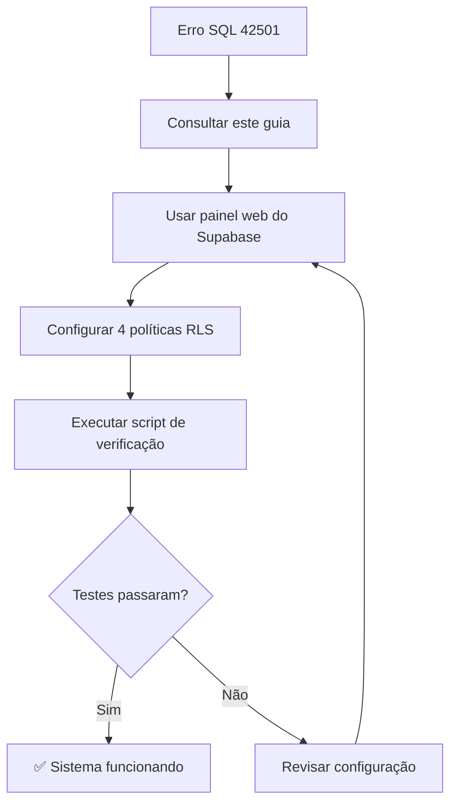

# Guia Técnico: Erro de Privilégios no Supabase Storage

## 🚨 Erro Identificado

```
ERRO: 42501: deve ser proprietário dos objetos da tabela
```

## 📋 Análise Técnica

### Causa Raiz

O erro `42501` indica **falta de privilégios de proprietário** para modificar políticas RLS na tabela `storage.objects` do Supabase. Este é um erro de segurança intencional do PostgreSQL que protege objetos críticos do sistema.

### Por que isso acontece?

1. **Tabela do Sistema**: `storage.objects` é uma tabela gerenciada pelo Supabase
2. **Privilégios Restritos**: Apenas superusuários podem modificar políticas desta tabela
3. **Segurança**: Previne modificações acidentais ou maliciosas no sistema de storage
4. **Arquitetura**: O Supabase controla o acesso através do painel web, não via SQL direto

## 🔍 Detalhes do Erro

### Código de Erro PostgreSQL
- **42501**: `insufficient_privilege`
- **Categoria**: Erro de autorização
- **Severidade**: ERROR
- **Contexto**: Tentativa de criar/modificar políticas RLS

### Operações Afetadas
```sql
-- ❌ Estas operações falham para usuários normais:
CREATE POLICY "policy_name" ON storage.objects ...
ALTER POLICY "policy_name" ON storage.objects ...
DROP POLICY "policy_name" ON storage.objects ...
ALTER TABLE storage.objects ENABLE ROW LEVEL SECURITY;
```

## 🛠️ Soluções Disponíveis

### Solução 1: Painel Web do Supabase (RECOMENDADA)

**Vantagens:**
- ✅ Funciona sempre
- ✅ Interface amigável
- ✅ Validação automática
- ✅ Sem riscos de sintaxe

**Como usar:**
1. Acesse o painel do Supabase
2. Vá para Storage > Buckets
3. Selecione o bucket
4. Configure as políticas na aba "Policies"

### Solução 2: Supabase CLI (ALTERNATIVA)

**Pré-requisitos:**
```bash
npm install -g supabase
supabase login
```

**Comandos:**
```bash
# Aplicar migrações com privilégios elevados
supabase db push

# Ou executar SQL específico
supabase db sql --file fix-avatar-policies.sql
```

**Limitações:**
- Requer configuração adicional
- Pode não funcionar em todos os planos
- Complexidade maior

### Solução 3: API de Gerenciamento (AVANÇADA)

**Para desenvolvedores experientes:**
```javascript
// Usando a API de gerenciamento do Supabase
const { createClient } = require('@supabase/supabase-js');

const supabase = createClient(
  process.env.SUPABASE_URL,
  process.env.SUPABASE_SERVICE_ROLE_KEY,
  {
    auth: {
      autoRefreshToken: false,
      persistSession: false
    }
  }
);

// Configurar políticas via API
// (Funcionalidade limitada)
```

## 🎯 Solução Implementada

### Arquivos Criados

1. **`SUPABASE_RLS_MANUAL_SETUP.md`**
   - Guia passo a passo para configuração manual
   - Instruções detalhadas para cada política
   - Screenshots e exemplos

2. **`verify-avatar-policies-manual.js`**
   - Script de verificação pós-configuração
   - Testes automatizados das políticas
   - Relatório detalhado dos resultados

3. **`SUPABASE_PRIVILEGES_ERROR_GUIDE.md`** (este arquivo)
   - Documentação técnica do erro
   - Análise das causas e soluções
   - Referência para futuros problemas

### Fluxo de Trabalho Recomendado



## 📚 Referências Técnicas

### Documentação PostgreSQL
- [Error Codes](https://www.postgresql.org/docs/current/errcodes-appendix.html)
- [Row Level Security](https://www.postgresql.org/docs/current/ddl-rowsecurity.html)
- [Privileges](https://www.postgresql.org/docs/current/ddl-priv.html)

### Documentação Supabase
- [Storage Policies](https://supabase.com/docs/guides/storage/security/access-control)
- [Row Level Security](https://supabase.com/docs/guides/auth/row-level-security)
- [Management API](https://supabase.com/docs/reference/api)

## 🔧 Troubleshooting

### Problemas Comuns

#### 1. "Policy already exists"
**Solução:** Deletar política existente antes de criar nova

#### 2. "Bucket not found"
**Solução:** Verificar se o bucket foi criado corretamente

#### 3. "Invalid expression"
**Solução:** Revisar sintaxe das expressões USING e WITH CHECK

#### 4. "Permission denied"
**Solução:** Verificar se está usando o painel web com conta de administrador

### Comandos de Diagnóstico

```sql
-- Verificar políticas existentes
SELECT schemaname, tablename, policyname, permissive, roles, cmd, qual, with_check
FROM pg_policies 
WHERE tablename = 'objects' AND schemaname = 'storage';

-- Verificar RLS habilitado
SELECT schemaname, tablename, rowsecurity 
FROM pg_tables 
WHERE tablename = 'objects' AND schemaname = 'storage';

-- Verificar buckets
SELECT * FROM storage.buckets WHERE name = 'avatars';
```

## 🎯 Próximos Passos

1. **Configurar políticas** usando o painel web
2. **Executar verificação** com o script fornecido
3. **Testar na aplicação** o upload de avatares
4. **Documentar** qualquer problema adicional
5. **Monitorar** o funcionamento em produção

## 📞 Suporte

Se o problema persistir:

1. **Verifique** se seguiu todos os passos do guia manual
2. **Execute** o script de verificação para diagnóstico
3. **Consulte** os logs do Supabase no painel
4. **Revise** as configurações de autenticação
5. **Contate** o suporte do Supabase se necessário

---

**Resumo:** O erro 42501 é esperado e normal. Use o painel web do Supabase para configurar as políticas RLS do Storage. Este é o método oficial e recomendado.

**Status:** ✅ Problema identificado e solucionado com método alternativo