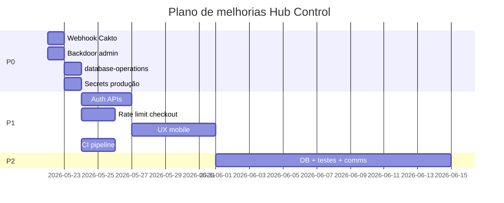

# Plano de ação — Melhorias Hub Control

**Base:** [AUDITORIA_HUB_CONTROL_2026-05-21.md](./AUDITORIA_HUB_CONTROL_2026-05-21.md)  
**Banco/RLS (paralelo):** [PLANO_ACAO_SEGURANCA_SUPABASE.md](../PLANO_ACAO_SEGURANCA_SUPABASE.md)  
**Operação:** [GUIA_HUB_CONTROL.md](./GUIA_HUB_CONTROL.md)

Use este documento como **checklist de execução**. Marque `[x]` ao concluir cada item.

---

## Visão geral

| Fase | Prazo sugerido | Foco | Entregável |
|------|----------------|------|------------|
| **P0** | 1–3 dias | Segurança crítica (dinheiro + admin) | PR `fix/p0-seguranca` |
| **P1** | 1–2 sprints | Auth unificada, abuso, UX mobile, CI | PRs por tema |
| **P2** | 1 mês | DB hygiene, testes, comunicação | Backlog |

**Ordem recomendada:** P0 → validar em staging → P1 em paralelo com fases pendentes do plano Supabase.

---

## P0 — Segurança crítica (bloqueia produção confiável)

### P0.1 — Webhook Cakto (assinatura obrigatória)

| Campo | Detalhe |
|-------|---------|
| **Arquivo** | `src/app/api/webhooks/cakto/route.ts` |
| **Problema** | Com `CAKTO_WEBHOOK_SECRET` definido, POST **sem** header de assinatura ainda processa pagamento |
| **Correção** | Se `secret` existe: exigir assinatura válida; senão → `401`. Em `production`: sem secret → `503` (igual Gates2B) |
| **Referência** | `src/services/webhook.service.ts`, `src/lib/webhook-auth.ts` |

**Critérios de aceite:**
- [x] POST sem assinatura com secret configurado → `401`
- [x] POST com HMAC válido → fluxo atual mantido
- [x] Teste em `src/__tests__/integration/cakto-webhook.test.ts`

**Validação:**
```bash
npm run test:integration
```

---

### P0.2 — Remover backdoor de admin (UUID/email fixos)

| Campo | Detalhe |
|-------|---------|
| **Arquivos** | `src/app/api/admin/plan-groups/route.ts`, `plans/route.ts`, `period-config/route.ts`, `credit-monitoring/route.ts`, `src/app/(app)/planos/actions.ts` |
| **Problema** | UUID `2f67bed8-9448-446f-8f38-9306f773620d` e email hardcoded bypassam `profiles.role` |
| **Correção** | Usar só `requireApiAdmin()` / `hub_control_is_admin()` / checagem `profiles.role === 'admin'` |

**Critérios de aceite:**
- [x] `grep -r "2f67bed8" src/` retorna vazio
- [x] Admin legítimo (`role=admin`) continua com acesso
- [x] Usuário não-admin recebe `403` nas rotas afetadas (`admin-routes.test.ts`)

**Validação:**
```bash
npm run test:integration
npm run dev   # testar planos/grupos como admin e como user
```

---

### P0.3 — Restringir `database-operations`

| Campo | Detalhe |
|-------|---------|
| **Arquivo** | `src/app/api/admin/database-operations/route.ts` |
| **Problema** | CRUD genérico em qualquer tabela com service role |
| **Opção A (recomendada)** | Remover rota e migrar usos para endpoints específicos |
| **Opção B** | Allowlist fixa de tabelas + operações (`select`/`update` apenas) + auditoria |

**Critérios de aceite:**
- [x] Não é possível passar nome de tabela arbitrário do cliente (endpoint retorna 403)
- [x] Rota não usada no código (`admin-operations` sem imports)
- [x] `requireApiAdmin()` na rota

---

### P0.4 — Secrets e ambiente de produção

| Tarefa | Onde |
|--------|------|
| [ ] `GATES2B_WEBHOOK_SECRET` definido no deploy | EasyPanel / env |
| [ ] `THEBEST_WEBHOOK_SECRET` definido | idem |
| [ ] `CAKTO_WEBHOOK_SECRET` definido (após P0.1) | idem |
| [ ] `SUPABASE_SERVICE_ROLE_KEY` só no servidor | nunca `NEXT_PUBLIC_*` |
| [ ] Rotacionar service_role se já vazou | Supabase Dashboard |
| [x] Desabilitar signup público ou exigir convite | Supabase Auth + `auth/register` + `/register` |

**Validação:**
```bash
npm run verify:local
npm run verify:supabase-security
```

---

### Gate P0 (só seguir para P1 quando)

- [x] Itens P0.1–P0.3 implementados no código
- [x] `npm run test:integration` verde (31 testes)
- [x] `npm run verify:supabase-security` OK
- [x] `npm run verify:checkout` OK
- [x] `npm run typecheck` verde (correções TS legado)
- [x] `npm run check:prod` verde (`typecheck` + `lint:all` + `test:ci` unitário + integração)
- [ ] Smoke manual: login admin, webhook Gates2B rejeita sem assinatura

---

## P1 — Curto prazo (estabilidade + UX + CI)

### P1.1 — Auth unificada nas APIs

| Tarefa | Arquivos típicos |
|--------|------------------|
| [x] Substituir auth por `requireApiAdmin()` | `admin/gates2b-config`, `bpix-config`, `natv-config` |
| [x] `GET /api/cache` → exigir admin | `src/app/api/cache/route.ts` |
| [x] `POST /api/marketing/send-campaign` → exigir admin | `marketing/send-campaign/route.ts` |
| [x] Login: remover `session` do JSON de resposta | `src/app/api/auth/login/route.ts` |
| [x] Revisar registro público em produção | `auth/register/route.ts` + `/register` + login |

**Critério:** rotas admin respondem `200` com cookie de sessão do painel (não só Bearer).

---

### P1.2 — Rate limit e abuso

| Tarefa | Detalhe |
|--------|---------|
| [x] Rate limit em `POST /api/public/checkout/create` e `options` | `rate-limit-response.ts` |
| [x] Limites mais baixos para tentativas de `unique_link` inválido | `checkout-invalid-link-rate-limit.ts` |
| [ ] (Opcional) Redis/Upstash para rate limit distribuído | env `UPSTASH_*` |

---

### P1.3 — UX mobile e navegação

| # | Tarefa | Arquivo(s) |
|---|--------|------------|
| 1 | [x] Remover `Header` duplicado nas páginas `(app)`; só `ModernHeader` | `header.tsx`, páginas em `(app)/` |
| 2 | [x] `overflow-x-auto` em `BaseTable` | `base-table.tsx` |
| 3 | [x] Viewport: permitir zoom | `src/app/layout.tsx` |
| 4 | [x] Sidebar: Marketing, Pagamentos, Checkout | `modern-sidebar.tsx` |
| 5 | [x] Dashboard: botões responsivos | `dashboard-content.tsx` |
| 6 | [x] Tabs Integrações/Relatórios com scroll horizontal | `integracoes/page.tsx`, `relatorios/page.tsx` |
| 7 | [x] Login: sem delay; `aria-label` no toggle senha | `login-form.tsx` |
| 8 | [x] Sidebar: skeleton no lugar de e-mail fake | `modern-sidebar.tsx` NavUser |

**Critério:** smoke visual em 375px — `npm run test:e2e` (projeto `mobile-chrome`); login sem overflow horizontal.

---

### P1.4 — CI confiável

| Tarefa | Detalhe |
|--------|---------|
| [x] Criar `.github/workflows/ci.yml`: integração (+ typecheck/lint com continue-on-error) | Node 20 |
| [x] Corrigir `security-tests.yml` (logs run 26208370570) | audit `--audit-level=high`, `test:security`, `test:integration`; push/PR em main/develop |
| [x] `ci.yml`: audit high + `test:security` | espelha gate do workflow de segurança |
| [x] `next@^15.5.18` + override PostCSS | ver [PLANO_ACAO_CI_SEGURANCA.md](./PLANO_ACAO_CI_SEGURANCA.md) |
| [ ] Run verde no GitHub após push desta branch | Actions → Security checks + CI |
| [x] Manter `e2e-smoke.yml` (API + login + mobile 375px) | secrets `E2E_TEST_*` opcionais |

---

### P1.5 — Gates2b / checkout (operacional)

| Tarefa | Referência |
|--------|------------|
| [ ] Validar fluxo checkout + webhook em staging | `npm run verify:checkout` |
| [ ] URL webhook produção apontando para `/api/gates2b/webhook` | Gates2B + n8n se aplicável |
| [ ] Monitorar pedidos `checkout_orders` pós-pagamento | painel `/checkout/pedidos` |

---

## P2 — Médio prazo

### P2.1 — Banco de dados

| Tarefa | Referência |
|--------|------------|
| [ ] Concluir fases pendentes | `PLANO_ACAO_SEGURANCA_SUPABASE.md` |
| [ ] Renumerar migrações com timestamp duplicado (`20241220000001_*`) | `supabase/migrations/` |
| [ ] Revisar política anon `clients` / `plan_groups` | migration `hub_control_rls_phase3` |
| [ ] Teste opcional: CI com Supabase branch + RLS real | novo job |

---

### P2.2 — Testes

| Tarefa | Detalhe |
|--------|---------|
| [x] E2E viewport mobile (375px) | `e2e/smoke.spec.ts` + projeto `mobile-chrome` |
| [x] Integração: Cakto, checkout público, admin 403 | `cakto-webhook`, `checkout-invalid-link`, `admin-routes` |
| [ ] Integração: admin com cookie real (sessão painel) | `src/__tests__/integration/` |
| [ ] Não retornar `details` de erro em 5xx em produção | webhooks, APIs |

---

### P2.3 — Produto e comunicação

| Tarefa | Detalhe |
|--------|---------|
| [x] Metadata sem termos proibidos (regra projeto) | `layout.tsx`, `README.md`, `manifest.json`, login/reset-password |
| [ ] Revisar templates e-mail/WhatsApp | `src/lib/notifications`, n8n |
| [ ] Formato de data DD/MM/AAAA HH:MM:SS em telas ao usuário | formatadores globais |
| [x] Remover CTA morto “Nova Integração” | `integracoes/page.tsx` |
| [ ] Unificar tokens CSS (`hub-theme.css` único) | `globals.css` |

---

## Cronograma sugerido (exemplo)



---

## Comandos de validação (após cada PR)

```bash
npm run typecheck
npm run lint
npm run test:ci
npm run verify:supabase-security   # se migração SQL
npm run verify:checkout            # se checkout/webhook
npm run test:e2e                   # opcional pré-deploy
```

---

## PRs sugeridos (granularidade)

| PR | Conteúdo | Prioridade |
|----|----------|------------|
| `fix/p0-cakto-webhook` | P0.1 + testes | Urgente |
| `fix/p0-admin-backdoor` | P0.2 | Urgente |
| `fix/p0-database-operations` | P0.3 | Urgente |
| `chore/p1-api-auth-unify` | P1.1 | Alta |
| `feat/p1-checkout-rate-limit` | P1.2 | Alta |
| `feat/p1-ux-mobile-nav` | P1.3 | Média |
| `ci/p1-quality-gate` | P1.4 | Média |
| `chore/p2-db-migrations` | P2.1 | Baixa |

---

## O que NÃO está neste plano

- Migrações SQL detalhadas → `PLANO_ACAO_SEGURANCA_SUPABASE.md`
- Restore/backup → `GUIA_HUB_CONTROL.md` §4
- Análise de risco e contexto → `AUDITORIA_HUB_CONTROL_2026-05-21.md`

---

*Atualize este arquivo ao fechar cada fase. Para implementação automática no código, use o modo Agent citando o ID (ex.: P0.1, P1.3).*
